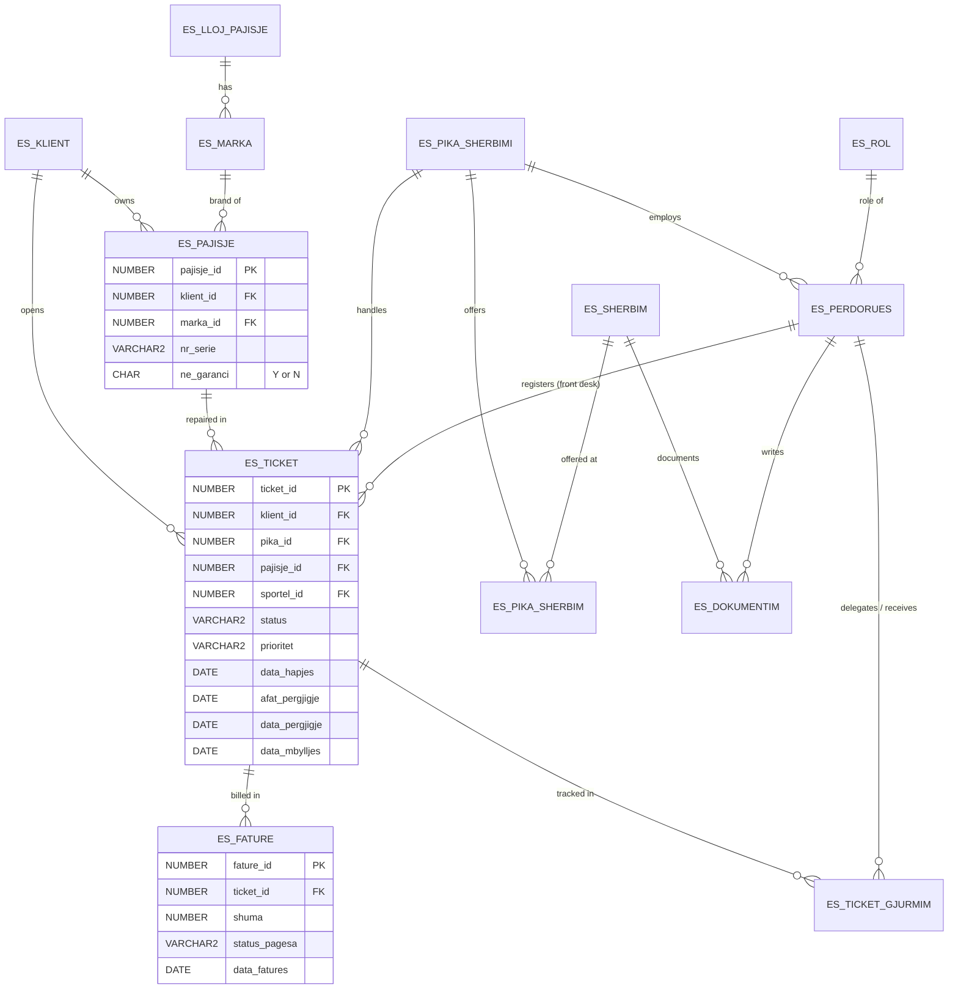

# eSupport System: Oracle Database

An Oracle database for a device repair and customer support company with several service points. It handles clients, devices and brands, support tickets for devices in and out of warranty, invoicing, a knowledge base of known problems, hand-overs of tickets between employees, response deadlines (SLA), delay alerts and statistical reports.

Built in **Oracle SQL and PL/SQL** as the course project for *Bazat e të Dhënave* (Databases), Polytechnic University of Tirana, 2025–2026.

> Table and column names are in Albanian. A short glossary is at the bottom.

## What's inside

| | Count | Examples |
|---|---|---|
| Tables | 13 | clients, devices, tickets, invoices, ticket tracking |
| Sequences | 12 | automatic primary keys |
| Stored procedures | 10 | open ticket (in/out of warranty), create invoice, delegate ticket, delay alerts |
| Triggers | 2 | auto-generated client ID, automatic hand-over date |
| Views (reports) | 10 | revenue by month, tickets per service point, delays, priorities |

**Main features**
- Separate procedures for opening tickets on devices **in warranty** and **out of warranty**, each rejecting the wrong case with a custom error
- Invoicing that refuses to bill devices still under warranty
- Closing a ticket once the service is performed
- Keyword search in a knowledge base of past problems and solutions
- **Ticket tracking:** a log of every hand-over from one employee to another
- **SLA deadlines:** each ticket gets a response deadline 3 days after opening, and a report shows how many days late each ticket is
- **Alert procedure** that lists late tickets and the employee responsible
- Priority levels (high / medium / low) with a priority report

## Database design



## Project structure

```
install.sql                 Runs everything below in order
sql/
  00_drop_all.sql           Removes all eSupport objects (for a clean re-install)
  01_schema.sql             Tables, constraints and sequences
  02_triggers.sql           Triggers
  03_procedures.sql         Stored procedures
  04_views.sql              Report views
  05_sample_data.sql        Test data, including tickets opened through the procedures
  06_demo_queries.sql       Example queries, reports and procedure calls
```

## How to run it

Requirements: Oracle Database (built with Oracle Database Free and SQL Developer) and a user with permission to create tables, sequences, procedures, triggers and views.

1. Connect to your schema in **SQL Developer**.
2. Open `install.sql` and press **F5** (Run Script). This builds the database and loads the test data.
3. Open `sql/06_demo_queries.sql` and press **F5** to see the reports and procedures in action. Output from procedures appears in the *Script Output* panel.

To start over, just run `install.sql` again. It drops the old objects first.

### Example

```sql
SET SERVEROUTPUT ON

-- Open a ticket for a device under warranty
EXEC ES_HAP_TICKET_GARANCI(1, 1, 1, 1, 'Laptop nuk ndizet');

-- Hand ticket 1 from employee 1 to employee 2
EXEC ES_DELEGO_TICKET(1, 1, 2, 'Deleguar te menaxheri');

-- Which tickets are late, and who is responsible?
EXEC ES_ALERT_VONESA;

-- Revenue per month
SELECT * FROM VW_FATURA_MUAJ;
```

## Glossary (Albanian → English)

| Albanian | English |
|---|---|
| klient | client |
| pika shërbimi | service point |
| shërbim | service |
| pajisje / lloj pajisje / markë | device / device type / brand |
| përdorues / rol | user / role |
| sportel | front desk |
| ticket gjurmim | ticket tracking |
| faturë / shuma / status pagesa | invoice / amount / payment status |
| dokumentim / zgjidhje | knowledge base / solution |
| garanci | warranty |
| afat përgjigje / vonesë | response deadline / delay |
| prioritet (lartë, mesatare, ulët) | priority (high, medium, low) |

## Author

**Alesia Maloku**, Computer Engineering student, Polytechnic University of Tirana.
